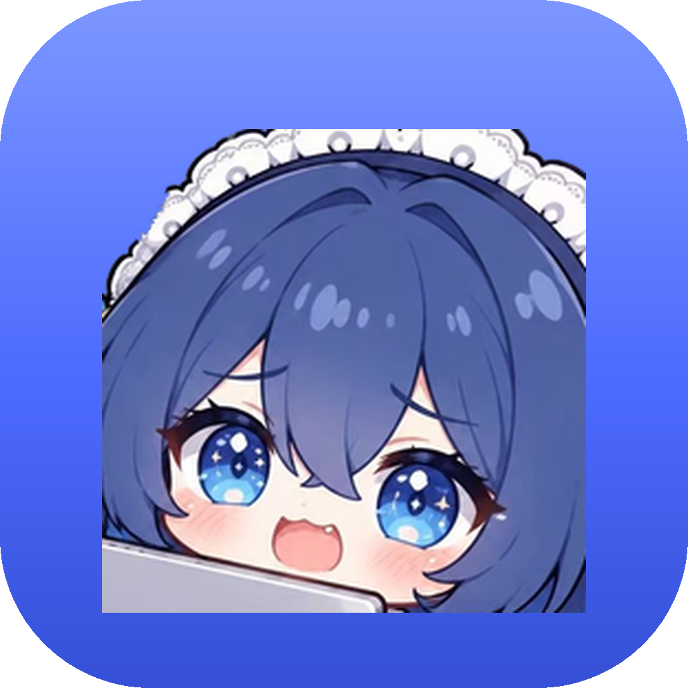
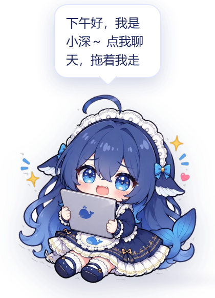
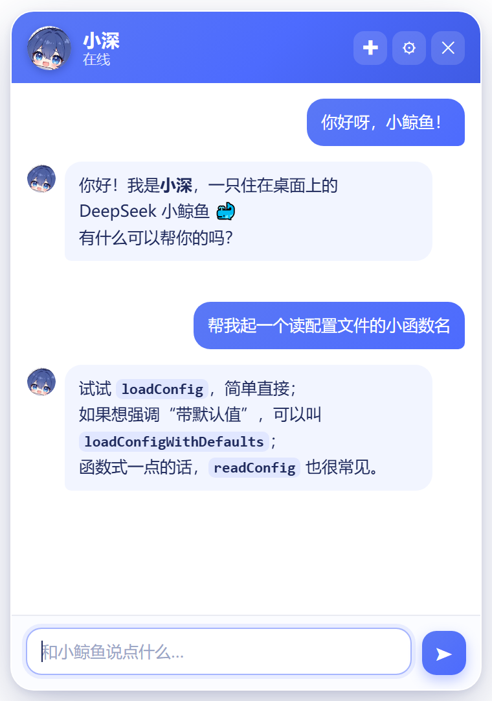
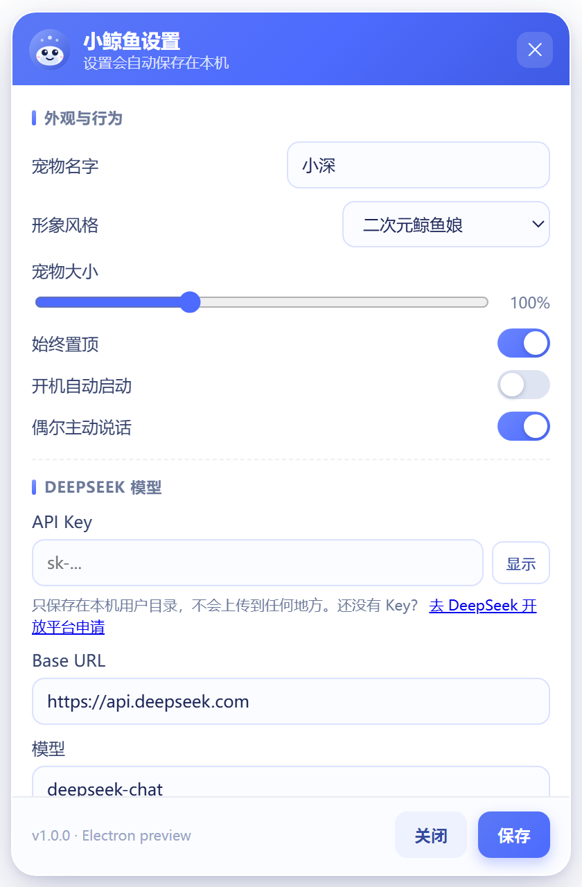

# 🐳 DeepSeek 桌面鲸鱼娘



一只住在桌面角落的 DeepSeek 鲸鱼娘（也可以一键切回简约小鲸鱼）：可以拖动、可以摸头、可以聊天、会提醒你喝水和专注。
纯 Electron + 原生 JavaScript，**没有数据库、没有后端、没有运行时依赖**，打包后是一个免安装的小 exe，发给朋友就能用。

[](LICENSE)
[](https://www.electronjs.org/)
[](#下载即用)



---

## 目录

- [它长什么样](#它长什么样)
- [功能一览](#功能一览)
- [下载即用](#下载即用推荐)
- [配置 API Key](#配置-api-key)
- [怎么玩](#怎么玩)
- [从源码运行](#从源码运行)
- [打包](#打包)
- [用 GitHub Actions 自动发布](#用-github-actions-自动发布不用本机装环境)
- [目录结构](#目录结构)
- [自定义](#自定义)
- [形象与素材说明](#形象与素材说明)
- [隐私与安全](#隐私与安全)
- [测试](#测试)
- [常见问题](#常见问题)
- [许可证与致谢](#许可证与致谢)

## 它长什么样

<p>
  
  
  
</p>

## 功能一览

**桌面宠物**

- 透明无边框小窗口（默认 210 × 290），始终置顶、不占任务栏
- 两种形象：二次元鲸鱼娘（默认）与简约小鲸鱼，设置里一键切换
- 只在角色身上响应鼠标，空白区域点击可以直接穿透到桌面
- 拖动换位置并记住；单击摸头（爱心 + 随机台词）、双击打开聊天、右键原生菜单
- 托盘常驻：聊天、显示/隐藏、番茄钟、喝水提醒开关、设置、退出
- 全局快捷键 `Ctrl / Cmd + Shift + Alt + D` 一键显示/隐藏
- 待机浮动、开心蹦跳、喜欢时摇一摇、困困时冒 zzz，气泡跟着说话
- 可调大小（70% ~ 160%）、可开机自启

**AI 对话**

- DeepSeek 官方 API 或任意 OpenAI 兼容接口（自定义 Base URL）
- 流式逐字输出、随时中断、消息复制
- `deepseek-reasoner` 的思考过程折叠展示
- 未配置 API Key 时使用内置台词兜底，装上就能玩
- 系统人设可改，默认是「短句、软萌、有元气」

**桌上小功能**

- 番茄钟：25/5 自动切换，托盘和宠物徽标都能控制，结束有气泡 + 系统通知
- 喝水提醒：默认 60 分钟，可改 15 ~ 240 分钟
- 偶尔主动说话：3 ~ 8 分钟随机一句，可关闭

## 下载即用（推荐）

到仓库的 [Releases](../../releases) 页面下载对应文件：

| 系统 | 文件 | 说明 |
| --- | --- | --- |
| Windows | `DeepSeekPet-x.y.z-portable.exe` | **免安装**，双击即用，推荐 |
| Windows | `DeepSeekPet-x.y.z-setup.exe` | 安装版，可创建桌面快捷方式 |
| macOS | `DeepSeekPet-x.y.z.dmg` | 首次打开需右键 →「打开」 |
| Linux | `DeepSeekPet-x.y.z.AppImage` | `chmod +x` 后直接运行 |

> 程序没有代码签名，Windows SmartScreen / macOS Gatekeeper 可能提示「未知发布者」。
> Windows 点「更多信息 → 仍要运行」；macOS 右键应用 →「打开」即可。

## 配置 API Key

1. 打开 <https://platform.deepseek.com/api_keys> 创建一个 API Key（需要先充值，按 token 计费）。
2. 右键小鲸鱼 →「设置…」，或托盘图标 →「设置…」。
3. 填进 **API Key**；Base URL 保持 `https://api.deepseek.com`，模型保持 `deepseek-chat`。
4. 点「测试连接」确认 Key 可用，再点「保存」。

聊天窗口标题下面显示「在线」就说明配好了；显示「未配置 API Key」时会用内置台词回你。

> **关于费用**：聊天请求直接发往你配置的接口，费用由你的 DeepSeek 账号承担，本项目不经过任何中间服务器。

## 怎么玩

| 操作 | 效果 |
| --- | --- |
| 左键单击小鲸鱼 | 摸头：爱心粒子 + 随机台词 |
| 双击小鲸鱼 | 打开聊天窗口 |
| 按住拖动 | 移动位置，松手后自动记住 |
| 右键小鲸鱼 | 聊天 / 摸头 / 番茄钟 / 喝水提醒 / 设置 / 藏起来 / 退出 |
| 点击左下角 🍅 徽标 | 开始或暂停番茄钟 |
| 托盘图标单击 / 右键 | 打开聊天 / 完整菜单 |
| `Ctrl / Cmd + Shift + Alt + D` | 显示或隐藏小鲸鱼 |
| 聊天框 `Enter` / `Shift + Enter` | 发送 / 换行 |
| 聊天框 `Esc` | 关闭聊天窗口 |

🌰 **小技巧**：把宠物缩到 80% 放在屏幕右下角，聊天窗口会自动贴在它旁边；番茄钟徽标在专注时会一直显示剩余时间。

## 从源码运行

需要 Node.js 18 或更新版本。

```bash
git clone https://github.com/<your-name>/deepseek-pet.git
cd deepseek-pet
npm install
npm start
```

国内网络如果下载 Electron 卡住，可以换镜像：

```bash
npm config set registry https://registry.npmmirror.com
set ELECTRON_MIRROR=https://npmmirror.com/mirrors/electron/   # Windows
export ELECTRON_MIRROR=https://npmmirror.com/mirrors/electron/ # macOS / Linux
```

开发时想直接看界面，也可以在浏览器里打开 `src/renderer/pet.html`（会自动使用预览桩，不会真的连 API）。

## 打包

```bash
npm run dist:win     # Windows：portable.exe + setup.exe
npm run dist:mac     # macOS：dmg
npm run dist:linux   # Linux：AppImage
```

产物在 `release/` 目录。第一次打包会下载对应平台的 Electron 二进制（约 100 MB），之后有缓存。

## 用 GitHub Actions 自动发布（不用本机装环境）

仓库已经带好两个工作流：

- `.github/workflows/ci.yml`：push / PR 时跑语法检查和单元测试
- `.github/workflows/release.yml`：推送 `v*` 标签时，自动在 Windows / macOS / Linux 上打包并创建 Release

发布新版本的步骤：

```bash
# 第一次上传：先在 GitHub 新建一个空仓库，然后
git remote add origin https://github.com/<your-name>/deepseek-pet.git
git branch -M main
git push -u origin main

# 之后每次发版
git add .
git commit -m "feat: 我的第一版桌面宠物"
git tag v1.0.0
git push origin main --tags
```

⚠️ 第一次使用前，请到仓库 **Settings → Actions → General → Workflow permissions** 选择
**Read and write permissions**，否则 Release 会因为拿不到 `GITHUB_TOKEN` 写权限而失败。

Actions 跑完后，Releases 页面会自动出现三个平台的安装包，朋友直接下载即可 —— 完全不需要你本机安装 Node、Electron 或任何编译环境。

## 目录结构

```text
deepseek-pet/
├─ main.js                    # 主进程：窗口、托盘、IPC、定时器
├─ preload.js                 # contextBridge 安全桥
├─ electron-builder.yml       # 三平台打包配置
├─ src/
│  ├─ main/
│  │  ├─ settings.js          # 配置默认值 + 校验 + 读写
│  │  ├─ chat.js              # DeepSeek SSE 流式请求
│  │  ├─ pomodoro.js          # 番茄钟状态机
│  │  └─ windows.js           # 尺寸、屏幕边界、窗口贴边计算
│  ├─ renderer/
│  │  ├─ pet.html/.css/.js    # 宠物窗口（两种形象 + 交互 + 动画）
│  │  ├─ chat.html/.css/.js   # 聊天面板
│  │  ├─ settings.html/.css/.js
│  │  └─ assets/              # 鲸鱼娘图、简约鲸鱼头像、托盘图
│  └─ shared/                 # 台词、Markdown、格式化（渲染进程 + 测试共用）
├─ scripts/                   # 语法检查、测试入口、切图、截图、图标生成
├─ test/                      # 单元测试 + 主进程冒烟测试
├─ test-support/              # 纯 Node 的 Electron 替身
├─ docs/screenshots/          # README 截图
└─ .github/workflows/         # CI 与自动发布
```

## 自定义

| 想改什么 | 改哪里 |
| --- | --- |
| 鲸鱼娘形象 | 替换 `src/renderer/assets/pet-girl.png`；或用自己的图跑 `python scripts/prepare-art.py 图片路径`（自动去白底、裁掉自带气泡、生成头像） |
| 简约小鲸鱼 | `src/renderer/pet.html` 里的内联 SVG，表情靠 `data-mood` 切换 |
| 台词 | `src/shared/quips.js`，所有气泡文案都在这里 |
| 宠物 / 聊天窗口大小 | `src/main/windows.js` 顶部的 `PET_BASE`、`CHAT_SIZE` |
| 人设 | 设置页的「小鲸鱼的人设」，或 `src/main/settings.js` 里的 `systemPrompt` 默认值 |
| 应用图标 | `python scripts/make-logo.py && python scripts/make-icons.py docs/screenshots/logo.png`（需要 Pillow） |

> 形象风格在设置页「形象风格」里切换；两种形象的交互、气泡、番茄钟徽标完全一致。

## 形象与素材说明

- 代码（含简约小鲸鱼 SVG、界面、图标排版）以 **MIT** 协议开源。
- 二次元「鲸鱼娘」立绘素材由项目使用者提供，**不在 MIT 授权范围内**，版权/使用许可请自行确认；公开发布前请确认你有权分发这张图。
- 想完全规避素材风险：把 `src/renderer/assets/pet-girl.png` 换成自己画的图，或在设置里切到「简约小鲸鱼」，并删除对应 PNG 即可。
- 自定义形象的合成方式见 `scripts/prepare-art.py`，它只做去底、裁切、缩放，不改变原画内容。

## 隐私与安全

- **只在小鲸鱼身上响应鼠标**：透明区域通过 `setIgnoreMouseEvents(..., { forward: true })` 做命中检测，不会挡住桌面点击。
- 聊天内容只会发送到你自己填写的 API 地址；项目没有任何统计、上报或中转服务器。
- 渲染进程开启 `contextIsolation` + `sandbox`，关闭 `nodeIntegration`，页面使用严格 CSP，外链交给系统浏览器打开。
- API Key 以明文保存在本机用户目录（Windows 大概是 `%APPDATA%\deepseek-pet\settings.json`），不会进入 Git 仓库（`.gitignore` 已排除相关文件）。不要把这份配置发给别人。

## 测试

```bash
npm test        # 8 个测试文件：配置校验、SSE 地址推导、真实流式解析、番茄钟、Markdown 安全、UI 接线、主进程冒烟
npm run check   # 对全部 .js 做 node --check 语法检查
```

其中：

- `test/chat-stream.test.js` 会起一个本地 HTTP 服务，真实验证 SSE 分包拼接、`[DONE]`、`reasoning_content`、401 提示和主动中断。
- `test/main-smoke.test.js` 用一个纯 Node 的 Electron 替身把主进程完整跑一遍：建窗口、存设置、拖拽、离线回复、番茄钟、右键菜单、退出清理，**不需要真的装 Electron，也不需要联网**。

## 常见问题

**小鲸鱼不见了？**
点托盘图标，或按 `Ctrl / Cmd + Shift + Alt + D`。也可能被拖到屏幕外了 —— 删掉 `%APPDATA%\deepseek-pet\settings.json` 里的 `position` 字段即可复位。

**聊天一直提示「未配置 API Key」？**
设置页保存后重新打开聊天窗口即可。如果填了 Key 还是不行，点「测试连接」看具体报错。

**连不上 / 401 / 404？**
- 401：Key 无效或没充值。
- 404：Base URL 写成 `https://api.deepseek.com/v1` 或 `https://api.deepseek.com` 都可以，但不要漏掉 `https`。
- 公司网络或代理：在系统代理里放行 `api.deepseek.com`。

**杀毒软件报毒？**
Electron 打包的未签名程序比较常见，可以加白名单，或用 `npm run dist` 自己打包。

**能改成本地模型吗？**
可以。Base URL 填本地 OpenAI 兼容服务（例如 `http://127.0.0.1:11434/v1`），模型填对应的模型名即可。

**想换回简约小鲸鱼？**
设置 →「形象风格」→ 简约小鲸鱼，保存后立刻生效。

**为什么窗口是透明的但有时候点不到？**
这是故意的：只有鼠标移到角色或气泡上才会接管点击，其他区域直接穿透。

## 许可证与致谢

- 代码以 [MIT](LICENSE) 协议开源，可自由修改、商用、二次发布。
- 简约小鲸鱼是本项目**原创绘制**的 SVG，造型灵感来自 DeepSeek 的鲸鱼吉祥物；「DeepSeek」名称与商标归其所有者，本项目与其没有隶属关系，也未使用其官方素材。
- 二次元鲸鱼娘立绘由使用者提供，授权范围见 [素材说明](docs/ART-NOTICE.md)，不在 MIT 覆盖范围内。
- 感谢 [Electron](https://www.electronjs.org/)、[electron-builder](https://www.electron.build/) 和 DeepSeek 开放平台。
